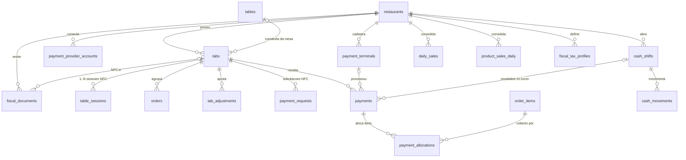

# PDV · 02 · Modelo de dados (PostgreSQL + Prisma) — Especificação de Implementação

> Especificação pronta para codificar migrations e `schema.prisma`.
> **Convenções reais do banco atual (`schema.prisma`):**
> - Todos os IDs são `String @id @default(uuid())` → tipo **`TEXT`** no PostgreSQL (nunca `UUID` nativo, para bater com as FKs existentes!).
> - Timestamps são `TIMESTAMP(3)` em UTC (Prisma `DateTime`).
> - Dinheiro sempre em centavos (`Int`), moeda `'BRL'`.
> - Isolamento multi-tenant via FKs compostas `(restaurant_id, ...)` e índices com `restaurant_id` na frente.
> - **Regra crítica do PostgreSQL:** `ALTER TYPE ... ADD VALUE` precisa ficar numa **migration separada** da migration que usa o novo valor em `CHECK`, `DEFAULT` ou `UPDATE` (o Postgres proíbe usar valor de enum recém-adicionado na mesma transação).
> - **Regra crítica de triggers:** `orders` e `order_items` têm `order_snapshot_guard` / `order_item_snapshot_guard`. Qualquer backfill exige `DISABLE TRIGGER` / `ENABLE TRIGGER` dentro da transação da migration.

---

## 1. Diagrama Entidade-Relacionamento


---

## 2. Alterações em enums e tabelas existentes

### 2.1 Migration A (somente `ADD VALUE` em enums existentes — Etapa 0 / Etapa 1)
```sql
-- Migration 1 (Etapa 0): novo papel de caixa
ALTER TYPE staff_category ADD VALUE 'CASHIER';

-- Migration 2 (Etapa 1): origem POS e modalidade COUNTER
ALTER TYPE order_source ADD VALUE 'POS';
ALTER TYPE order_fulfillment ADD VALUE 'COUNTER';
```

### 2.2 Alterações em `restaurants` (Etapa 0)
```prisma
// Adicionar em model restaurants:
timezone                    String   @default("America/Sao_Paulo") @db.VarChar(64)
business_day_cutoff_minutes Int      @default(0)
service_fee_bps             Int      @default(1000)
next_tab_number             Int      @default(1)
```
```sql
ALTER TABLE restaurants
  ADD COLUMN timezone VARCHAR(64) NOT NULL DEFAULT 'America/Sao_Paulo',
  ADD COLUMN business_day_cutoff_minutes INTEGER NOT NULL DEFAULT 0,
  ADD COLUMN service_fee_bps INTEGER NOT NULL DEFAULT 1000,
  ADD COLUMN next_tab_number INTEGER NOT NULL DEFAULT 1;

ALTER TABLE restaurants ADD CONSTRAINT restaurants_pdv_config_valid
  CHECK (business_day_cutoff_minutes BETWEEN 0 AND 719
     AND service_fee_bps BETWEEN 0 AND 3000
     AND next_tab_number > 0
     AND length(btrim(timezone)) > 0);
```

### 2.3 Atualização do CHECK de `order_events` (Etapa 0 + Etapa 1)
```sql
-- Etapa 0: incluir CASHIER no snapshot de ator
ALTER TABLE order_events DROP CONSTRAINT order_event_valid_actor_snapshot;
ALTER TABLE order_events ADD CONSTRAINT order_event_valid_actor_snapshot
  CHECK ((actor_type = 'USER' AND actor_role_snapshot IS NOT NULL AND actor_label_snapshot IS NOT NULL
          AND length(btrim(actor_label_snapshot)) > 0
          AND ((actor_role_snapshot = 'OWNER' AND actor_category_snapshot IS NULL)
            OR (actor_role_snapshot = 'STAFF' AND actor_category_snapshot IS NOT NULL
                AND actor_category_snapshot IN ('MANAGER','WAITER','KITCHEN','CASHIER'))))
      OR (actor_type = 'TABLE_DEVICE' AND actor_user_id IS NULL AND actor_role_snapshot IS NULL
          AND actor_category_snapshot IS NULL AND actor_label_snapshot IS NULL));

-- Etapa 1: permitir CREATED por USER (pedido lançado no PDV)
ALTER TABLE order_events DROP CONSTRAINT order_event_valid_transition;
ALTER TABLE order_events ADD CONSTRAINT order_event_valid_transition
  CHECK (sequence > 0 AND resulting_order_version > 0
         AND ((action = 'CREATED' AND sequence = 1 AND resulting_order_version = 1
               AND order_item_id IS NULL AND quantity IS NULL
               AND from_stage IS NULL AND to_stage IS NULL AND reason IS NULL
               AND actor_type IN ('TABLE_DEVICE', 'USER'))
          OR (action = 'TRANSITIONED' AND order_item_id IS NOT NULL
               AND quantity IS NOT NULL AND quantity BETWEEN 1 AND 20 AND actor_type = 'USER'
               AND from_stage IS NOT NULL AND to_stage IS NOT NULL
               AND ((from_stage = 'PENDING' AND to_stage IN ('PREPARING','READY','DELIVERED','CANCELLED'))
                 OR (from_stage = 'PREPARING' AND to_stage IN ('READY','DELIVERED','CANCELLED'))
                 OR (from_stage = 'READY' AND to_stage IN ('DELIVERED','CANCELLED')))
               AND ((to_stage = 'CANCELLED' AND reason IS NOT NULL AND length(btrim(reason)) BETWEEN 3 AND 500)
                    OR (to_stage <> 'CANCELLED' AND reason IS NULL)))));
```

### 2.4 Alterações em `table_sessions` e `session_tokens` (Etapa 1 / Etapa 2)
```sql
-- Etapa 1: table_sessions aponta para tabs (1 comanda sobrevive a N sessões NFC após timeout)
ALTER TABLE table_sessions ADD COLUMN tab_id TEXT;
ALTER TABLE table_sessions ADD CONSTRAINT table_sessions_tab_fkey
  FOREIGN KEY (restaurant_id, tab_id) REFERENCES tabs(restaurant_id, id)
  ON DELETE RESTRICT ON UPDATE RESTRICT;
CREATE INDEX table_sessions_restaurant_tab_idx ON table_sessions(restaurant_id, tab_id);

-- Etapa 2: apelido opcional do aparelho no NFC
ALTER TABLE session_tokens ADD COLUMN guest_label VARCHAR(60);
```

### 2.5 Alterações em `orders`, `order_items` e trigger `menu_guard_order_record` (Etapa 1)
```sql
ALTER TABLE orders
  ADD COLUMN tab_id TEXT,
  ADD COLUMN submitted_by_user_id TEXT;

ALTER TABLE order_items
  ADD COLUMN category_id_snapshot TEXT,
  ADD COLUMN category_name_snapshot VARCHAR(120) NOT NULL DEFAULT 'Sem categoria';

-- Se já existirem pedidos históricos no banco, fazer backfill sob DISABLE TRIGGER:
ALTER TABLE orders DISABLE TRIGGER order_snapshot_guard;
-- (1) criar uma tab CLOSED/OPEN por session_id existente e atualizar orders.tab_id e table_sessions.tab_id
-- (2) atualizar restaurants.next_tab_number = MAX(number) + 1
ALTER TABLE orders ENABLE TRIGGER order_snapshot_guard;

ALTER TABLE orders ALTER COLUMN tab_id SET NOT NULL;
ALTER TABLE orders ADD CONSTRAINT orders_tab_fkey
  FOREIGN KEY (restaurant_id, tab_id) REFERENCES tabs(restaurant_id, id)
  ON DELETE RESTRICT ON UPDATE RESTRICT;
ALTER TABLE orders ADD CONSTRAINT orders_submitted_by_user_fkey
  FOREIGN KEY (submitted_by_user_id) REFERENCES users(id)
  ON DELETE SET NULL ON UPDATE CASCADE;
CREATE INDEX orders_restaurant_tab_created_idx ON orders(restaurant_id, tab_id, created_at);

-- Atualizar CHECK de origem/modalidade:
ALTER TABLE orders DROP CONSTRAINT order_valid_current_source;
ALTER TABLE orders ADD CONSTRAINT order_valid_current_source
  CHECK (publication_id IS NOT NULL
         AND length(btrim(table_label_snapshot)) > 0
         AND ((source = 'LOCAL_MENU' AND fulfillment_type = 'DINE_IN'
               AND session_id IS NOT NULL AND submitted_by_user_id IS NULL)
           OR (source = 'POS' AND fulfillment_type IN ('DINE_IN', 'COUNTER')
               AND submitted_by_token_id IS NULL)));

-- Recriar trigger permitindo: submitted_by_user_id -> NULL e troca de tab_id (transferência/junção controlada)
CREATE OR REPLACE FUNCTION menu_guard_order_record() RETURNS trigger LANGUAGE plpgsql AS $$
BEGIN
  IF TG_OP = 'DELETE' THEN
    RAISE EXCEPTION 'Orders and item snapshots cannot be deleted' USING ERRCODE = '23514';
  END IF;
  IF TG_TABLE_NAME = 'orders' THEN
    IF (to_jsonb(NEW) - ARRAY['version','last_event_sequence','updated_at','submitted_by_token_id','submitted_by_user_id','tab_id','table_label_snapshot'])
       IS DISTINCT FROM
       (to_jsonb(OLD) - ARRAY['version','last_event_sequence','updated_at','submitted_by_token_id','submitted_by_user_id','tab_id','table_label_snapshot'])
       OR NEW.version < OLD.version OR NEW.last_event_sequence < OLD.last_event_sequence
       OR (NEW.submitted_by_token_id IS DISTINCT FROM OLD.submitted_by_token_id AND NEW.submitted_by_token_id IS NOT NULL)
       OR (NEW.submitted_by_user_id IS DISTINCT FROM OLD.submitted_by_user_id AND NEW.submitted_by_user_id IS NOT NULL) THEN
      RAISE EXCEPTION 'Order financial/context snapshot is immutable' USING ERRCODE = '23514';
    END IF;
  ELSIF TG_TABLE_NAME = 'order_items' THEN
    IF (to_jsonb(NEW) - ARRAY['pending_quantity','preparing_quantity','ready_quantity','delivered_quantity','cancelled_quantity'])
       IS DISTINCT FROM
       (to_jsonb(OLD) - ARRAY['pending_quantity','preparing_quantity','ready_quantity','delivered_quantity','cancelled_quantity']) THEN
      RAISE EXCEPTION 'Order item financial snapshot is immutable' USING ERRCODE = '23514';
    END IF;
  ELSE
    RAISE EXCEPTION 'Order selection snapshot is immutable' USING ERRCODE = '23514';
  END IF;
  RETURN NEW;
END $$;
```

---

## 3. Schema Prisma das novas tabelas (pronto para copiar por etapa)

### 3.1 Etapa 1 — `tabs`
```prisma
enum tab_kind {
  TABLE
  COUNTER
}

enum tab_status {
  OPEN
  CLOSING
  CLOSED
  CANCELLED
}

model tabs {
  id                       String             @id @default(uuid())
  restaurant_id            String
  number                   Int
  kind                     tab_kind
  table_id                 String?
  table_label_snapshot     String?            @db.VarChar(120)
  label                    String?            @db.VarChar(80)
  guests_count             Int?
  status                   tab_status         @default(OPEN)
  service_fee_bps          Int                @default(1000)
  service_fee_waived       Boolean            @default(false)
  service_fee_waive_reason String?            @db.VarChar(500)
  subtotal_cents           Int                @default(0)
  service_fee_cents        Int                @default(0)
  adjustments_cents        Int                @default(0)
  total_cents              Int                @default(0)
  paid_cents               Int                @default(0)
  closed_refunded_cents    Int                @default(0)
  legacy_closed            Boolean            @default(false)
  business_date            DateTime?          @db.Date
  opened_by_user_id        String?
  closed_by_user_id        String?
  cancel_reason            String?            @db.VarChar(500)
  version                  Int                @default(1)
  opened_at                DateTime           @default(now())
  closed_at                DateTime?
  updated_at               DateTime           @default(now()) @updatedAt

  restaurant               restaurants        @relation(fields: [restaurant_id], references: [id], onDelete: Restrict)
  table                    tables?            @relation("tabs_table", fields: [restaurant_id, table_id], references: [restaurant_id, id], onDelete: Restrict, onUpdate: Restrict)
  opened_by                users?             @relation("tabs_opened_by", fields: [opened_by_user_id], references: [id], onDelete: SetNull)
  closed_by                users?             @relation("tabs_closed_by", fields: [closed_by_user_id], references: [id], onDelete: SetNull)
  sessions                 table_sessions[]
  orders                   orders[]
  adjustments              tab_adjustments[]
  payment_requests         payment_requests[]
  payments                 payments[]
  fiscal_documents         fiscal_documents[]

  @@unique([restaurant_id, id])
  @@unique([restaurant_id, number])
  @@index([restaurant_id, status, opened_at])
  @@index([restaurant_id, business_date, status])
  @@index([restaurant_id, table_id, status])
}
```
**SQL manual obrigatório na migration da Etapa 1:**
```sql
-- Apenas 1 comanda aberta/em fechamento por mesa
CREATE UNIQUE INDEX tabs_one_open_per_table
  ON tabs (restaurant_id, table_id)
  WHERE kind = 'TABLE' AND status IN ('OPEN', 'CLOSING');

ALTER TABLE tabs ADD CONSTRAINT tabs_valid_invariants CHECK (
  number > 0
  AND version > 0
  AND service_fee_bps BETWEEN 0 AND 3000
  AND subtotal_cents >= 0 AND service_fee_cents >= 0
  AND total_cents >= 0 AND paid_cents >= 0 AND closed_refunded_cents >= 0
  AND (guests_count IS NULL OR guests_count > 0)
  AND ((kind = 'TABLE' AND table_id IS NOT NULL) OR (kind = 'COUNTER' AND table_id IS NULL))
  AND ((service_fee_waived = false) OR (service_fee_waive_reason IS NOT NULL AND length(btrim(service_fee_waive_reason)) BETWEEN 3 AND 500))
  AND ((status <> 'CANCELLED') OR (cancel_reason IS NOT NULL AND length(btrim(cancel_reason)) BETWEEN 3 AND 500))
  AND (status = 'CLOSED' OR closed_refunded_cents = 0)
  AND (NOT legacy_closed OR (status = 'CLOSED' AND paid_cents = 0 AND closed_refunded_cents = 0))
  AND ((status <> 'CLOSED') OR (closed_at IS NOT NULL AND business_date IS NOT NULL
       AND (legacy_closed OR paid_cents::bigint + closed_refunded_cents = total_cents)))
);
```
**[Implementado] CHECK atual:** a versão acima é a da migration `20261120170000_tab_closing_and_payments`, que substituiu a da Etapa 1 (`paid_cents = total_cents` quando `CLOSED`). `closed_refunded_cents` soma os estornos feitos com a comanda já `CLOSED` (a comanda continua `CLOSED` e `paid_cents` diminui); só é diferente de zero em comanda `CLOSED`.

**`tabs.legacy_closed` [Implementado]:** marca comandas convertidas do legado (migration `20261120160100_tabs_and_pos_orders`): sessões antigas fechadas com pedidos, que não registravam pagamentos. Têm `status = CLOSED`, `paid_cents = 0` e ficam isentas da regra `paid = total`. Preservam o consumo sem atestar receita, então os relatórios de receita por encerramento devem filtrar `legacy_closed = false`.

### 3.2 Etapa 2 — `tab_adjustments`, `payment_requests`, `payments`, `payment_allocations`
```prisma
enum tab_adjustment_type {
  DISCOUNT
  COUVERT
  TIP
}

enum tab_adjustment_mode {
  FIXED_CENTS
  PERCENT_BPS
}

enum payment_method {
  CASH
  CREDIT
  DEBIT
  PIX
  VOUCHER
  OTHER
}

enum payment_status {
  PENDING
  PROCESSING
  APPROVED
  DECLINED
  CANCELLED
  EXPIRED
  REFUNDED
}

enum payment_provider_type {
  MANUAL
  MERCADO_PAGO
  STONE
  PAGBANK
  CIELO
  PAYGO
  SITEF
}

enum payment_request_status {
  OPEN
  ACCEPTED
  CONVERTED
  CANCELLED
  EXPIRED
}

model tab_adjustments {
  id                 String              @id @default(uuid())
  restaurant_id      String
  tab_id             String
  type               tab_adjustment_type
  mode               tab_adjustment_mode
  value              Int
  computed_cents     Int
  reason             String              @db.VarChar(500)
  created_by_user_id String?
  created_at         DateTime            @default(now())
  removed_at         DateTime?
  removed_by_user_id String?
  remove_reason      String?             @db.VarChar(500)

  tab                tabs                @relation(fields: [restaurant_id, tab_id], references: [restaurant_id, id], onDelete: Restrict)

  @@unique([restaurant_id, id])
  @@index([restaurant_id, tab_id, removed_at])
}

model payment_requests {
  id                     String                 @id @default(uuid())
  restaurant_id          String
  tab_id                 String
  session_token_id       String
  payer_label            String                 @db.VarChar(60)
  preferred_method       payment_method
  requested_amount_cents Int
  selection_json         Json
  status                 payment_request_status @default(OPEN)
  payment_id             String?
  handled_by_user_id     String?
  created_at             DateTime               @default(now())
  updated_at             DateTime               @default(now()) @updatedAt

  tab                    tabs                   @relation(fields: [restaurant_id, tab_id], references: [restaurant_id, id], onDelete: Restrict)

  @@unique([restaurant_id, id])
  @@index([restaurant_id, tab_id, status])
}

model payments {
  id                   String                @id @default(uuid())
  restaurant_id        String
  tab_id               String
  cash_shift_id        String?
  provider             payment_provider_type @default(MANUAL)
  terminal_id          String?
  method               payment_method
  status               payment_status
  amount_cents         Int
  received_cents       Int?
  change_cents         Int                   @default(0)
  tip_cents            Int                   @default(0)
  provider_fee_cents   Int?
  payer_label          String?               @db.VarChar(60)
  idempotency_key      String                @db.VarChar(64)
  external_payment_id  String?               @db.VarChar(128)
  nsu                  String?               @db.VarChar(64)
  authorization_code   String?               @db.VarChar(64)
  card_brand           String?               @db.VarChar(32)
  acquirer_cnpj        String?               @db.VarChar(14)
  installments         Int                   @default(1)
  raw_provider_payload Json?
  actor_user_id        String?
  refund_reason        String?               @db.VarChar(500)
  refunded_by_user_id  String?
  confirmed_at         DateTime?
  refunded_at          DateTime?
  created_at           DateTime              @default(now())
  updated_at           DateTime              @default(now()) @updatedAt

  tab                  tabs                  @relation(fields: [restaurant_id, tab_id], references: [restaurant_id, id], onDelete: Restrict)
  cash_shift           cash_shifts?          @relation(fields: [restaurant_id, cash_shift_id], references: [restaurant_id, id], onDelete: Restrict)
  terminal             payment_terminals?    @relation(fields: [restaurant_id, terminal_id], references: [restaurant_id, id], onDelete: Restrict)
  allocations          payment_allocations[]

  @@unique([restaurant_id, id])
  @@unique([restaurant_id, idempotency_key])
  @@index([restaurant_id, tab_id, status])
  @@index([restaurant_id, cash_shift_id, status])
  @@index([provider, external_payment_id])
  @@index([status, updated_at])
}

model payment_allocations {
  id                String      @id @default(uuid())
  restaurant_id     String
  payment_id        String
  order_item_id     String
  covered_cents     Int
  covered_units_bps Int?

  payment           payments    @relation(fields: [restaurant_id, payment_id], references: [restaurant_id, id], onDelete: Restrict)
  order_item        order_items @relation(fields: [order_item_id], references: [id], onDelete: Restrict)

  @@index([restaurant_id, payment_id])
  @@index([restaurant_id, order_item_id])
}
```
**SQL manual obrigatório na migration da Etapa 2:**
```sql
-- 1 solicitação OPEN por aparelho NFC por comanda (evita spam de solicitações)
CREATE UNIQUE INDEX payment_requests_one_open_per_token
  ON payment_requests (restaurant_id, tab_id, session_token_id)
  WHERE status = 'OPEN';

ALTER TABLE tab_adjustments ADD CONSTRAINT tab_adjustments_valid CHECK (
  value > 0
  AND length(btrim(reason)) BETWEEN 3 AND 500
  AND ((type = 'DISCOUNT' AND computed_cents <= 0) OR (type <> 'DISCOUNT' AND computed_cents >= 0))
  AND ((mode <> 'PERCENT_BPS') OR (value BETWEEN 1 AND 10000))
);

ALTER TABLE payments ADD CONSTRAINT payments_valid CHECK (
  amount_cents > 0 AND change_cents >= 0 AND tip_cents >= 0 AND installments >= 1
  AND (received_cents IS NULL OR received_cents >= amount_cents)
  AND (change_cents = 0 OR (method = 'CASH' AND received_cents IS NOT NULL AND change_cents = received_cents - amount_cents))
  AND ((status <> 'REFUNDED') OR (refund_reason IS NOT NULL AND length(btrim(refund_reason)) BETWEEN 3 AND 500 AND refunded_at IS NOT NULL))
);

ALTER TABLE payment_allocations ADD CONSTRAINT payment_allocations_valid CHECK (
  covered_cents > 0 AND (covered_units_bps IS NULL OR covered_units_bps > 0)
);
```

### 3.3 Etapa 3 — `cash_shifts` e `cash_movements`
```prisma
enum cash_shift_status {
  OPEN
  CLOSED
}

enum cash_movement_type {
  SANGRIA
  SUPRIMENTO
}

model cash_shifts {
  id                  String            @id @default(uuid())
  restaurant_id       String
  opened_by_user_id   String
  closed_by_user_id   String?
  status              cash_shift_status @default(OPEN)
  opening_cents       Int
  expected_cash_cents Int               @default(0)
  counted_cash_cents  Int?
  difference_cents    Int?
  notes               String?           @db.VarChar(500)
  opened_at           DateTime          @default(now())
  closed_at           DateTime?

  restaurant          restaurants       @relation(fields: [restaurant_id], references: [id], onDelete: Restrict)
  payments            payments[]
  movements           cash_movements[]

  @@unique([restaurant_id, id])
  @@index([restaurant_id, status, opened_at])
}

model cash_movements {
  id            String             @id @default(uuid())
  restaurant_id String
  cash_shift_id String
  type          cash_movement_type
  amount_cents  Int
  reason        String             @db.VarChar(500)
  actor_user_id String?
  created_at    DateTime           @default(now())

  cash_shift    cash_shifts        @relation(fields: [restaurant_id, cash_shift_id], references: [restaurant_id, id], onDelete: Restrict)

  @@index([restaurant_id, cash_shift_id, created_at])
}
```
**SQL manual obrigatório na Etapa 3:**
```sql
CREATE UNIQUE INDEX cash_shifts_one_open_per_operator
  ON cash_shifts (restaurant_id, opened_by_user_id)
  WHERE status = 'OPEN';

ALTER TABLE cash_shifts ADD CONSTRAINT cash_shifts_valid CHECK (
  opening_cents >= 0 AND expected_cash_cents >= 0
  AND (counted_cash_cents IS NULL OR counted_cash_cents >= 0)
  AND ((status <> 'CLOSED') OR (closed_at IS NOT NULL AND counted_cash_cents IS NOT NULL
                                AND difference_cents = counted_cash_cents - expected_cash_cents))
);
ALTER TABLE cash_movements ADD CONSTRAINT cash_movements_valid CHECK (
  amount_cents > 0 AND length(btrim(reason)) BETWEEN 3 AND 500
);
```

### 3.4 Etapa 4 — `payment_provider_accounts` e `payment_terminals`
```prisma
enum provider_environment {
  SANDBOX
  PRODUCTION
}

enum provider_account_status {
  ACTIVE
  REVOKED
}

model payment_provider_accounts {
  id                       String                  @id @default(uuid())
  restaurant_id            String
  provider                 payment_provider_type
  environment              provider_environment    @default(SANDBOX)
  status                   provider_account_status @default(ACTIVE)
  external_account_id      String?                 @db.VarChar(128)
  access_token_encrypted   String
  refresh_token_encrypted  String?
  token_expires_at         DateTime?
  webhook_secret_encrypted String?
  metadata_json            Json?
  created_at               DateTime                @default(now())
  updated_at               DateTime                @default(now()) @updatedAt

  restaurant               restaurants             @relation(fields: [restaurant_id], references: [id], onDelete: Restrict)
  terminals                payment_terminals[]

  @@unique([restaurant_id, id])
  @@unique([restaurant_id, provider, environment])
}
// [Implementado] webhook_secret_encrypted está reservado e não é usado: hoje o segredo do webhook
// vem de MERCADO_PAGO_WEBHOOK_SECRET no ambiente (global). Decisão pendente: DEC-18.

model payment_terminals {
  id                  String                     @id @default(uuid())
  restaurant_id       String
  provider_account_id String?
  provider            payment_provider_type
  external_device_id  String?                    @db.VarChar(128)
  serial_number       String?                    @db.VarChar(128)
  label               String                     @db.VarChar(80)
  active              Boolean                    @default(true)
  last_seen_at        DateTime?
  metadata_json       Json?
  created_at          DateTime                   @default(now())
  updated_at          DateTime                   @default(now()) @updatedAt

  restaurant          restaurants                @relation(fields: [restaurant_id], references: [id], onDelete: Restrict)
  provider_account    payment_provider_accounts? @relation(fields: [restaurant_id, provider_account_id], references: [restaurant_id, id], onDelete: Restrict)
  payments            payments[]

  @@unique([restaurant_id, id])
  @@index([restaurant_id, active])
}
```
```sql
CREATE UNIQUE INDEX payment_terminals_unique_device
  ON payment_terminals (restaurant_id, provider, external_device_id)
  WHERE external_device_id IS NOT NULL;
```

### 3.5 Etapa 5 — `daily_sales` e `product_sales_daily`
```prisma
model daily_sales {
  restaurant_id         String
  business_date         DateTime    @db.Date
  tabs_closed_count     Int         @default(0)
  tabs_cancelled_count  Int         @default(0)
  table_tabs_count      Int         @default(0)
  counter_tabs_count    Int         @default(0)
  guests_total          Int         @default(0)
  gross_sales_cents     Int         @default(0)
  cancelled_items_cents Int         @default(0)
  discounts_cents       Int         @default(0)
  service_fee_cents     Int         @default(0)
  couvert_cents         Int         @default(0)
  tips_cents            Int         @default(0)
  net_sales_cents       Int         @default(0)
  cash_cents            Int         @default(0)
  credit_cents          Int         @default(0)
  debit_cents           Int         @default(0)
  pix_cents             Int         @default(0)
  voucher_cents         Int         @default(0)
  other_cents           Int         @default(0)
  provider_fees_cents   Int         @default(0)
  total_stay_seconds    BigInt      @default(0)
  rebuilt_at            DateTime    @default(now())

  restaurant            restaurants @relation(fields: [restaurant_id], references: [id], onDelete: Restrict)

  @@id([restaurant_id, business_date])
  @@index([restaurant_id, business_date])
}

model product_sales_daily {
  restaurant_id          String
  business_date          DateTime    @db.Date
  product_id             String
  variant_id             String
  hour_bucket            Int         // 0..23 no fuso do restaurante
  product_name_snapshot  String      @db.VarChar(120)
  variant_name_snapshot  String      @db.VarChar(120)
  category_name_snapshot String      @db.VarChar(120)
  quantity_sold          Int         @default(0)
  quantity_cancelled     Int         @default(0)
  revenue_cents          Int         @default(0)

  restaurant             restaurants @relation(fields: [restaurant_id], references: [id], onDelete: Restrict)

  @@id([restaurant_id, business_date, product_id, variant_id, hour_bucket])
  @@index([restaurant_id, business_date])
  @@index([restaurant_id, product_id, business_date])
}
```
*(Nota: `total_stay_seconds` como `BigInt` evita overflow e permite calcular a média exata em qualquer janela semanal/mensal: `SUM(total_stay_seconds) / SUM(tabs_closed_count)`!)*

### 3.6 Etapa 6 — `fiscal_settings`, `fiscal_tax_profiles`, `fiscal_documents`
> **Implementado com diferenças:** veja `schema.prisma` e a migration `20261121100000_fiscal_nfce`, que mandam sobre o esboço abaixo.
> - `fiscal_settings` não guarda IE, CRT, CSC, série nem `next_nfce_number`, que ficam no provedor. A credencial é opcional para o `MOCK`.
> - `fiscal_documents` ganhou `PROCESSING`, `attempt`, `external_id`, `total_cents`, `environment`, `dispatched_at` e `cancel_requested_at`. É uma nota por comanda (`@@unique([restaurant_id, tab_id])`), e o número e a série vêm do provedor.
> - O perfil em `menu_products` usa FK composta `RESTRICT`, sem rota de exclusão de perfil.
> - Regras e fluxo: `pdv-04` §4.
```prisma
enum fiscal_provider_type {
  MOCK
  NOTAAS
  FOCUS_NFE
}

enum fiscal_environment {
  HOMOLOGACAO
  PRODUCAO
}

enum fiscal_document_status {
  PENDING
  AUTHORIZED
  REJECTED
  CANCELLED
}

model fiscal_tax_profiles {
  id            String      @id @default(uuid())
  restaurant_id String
  name          String      @db.VarChar(80)
  ncm           String      @db.VarChar(8)
  cfop          String      @db.VarChar(4)
  csosn         String      @db.VarChar(4)
  origin        Int         @default(0)
  unit          String      @default("UN") @db.VarChar(6)
  created_at    DateTime    @default(now())

  restaurant    restaurants @relation(fields: [restaurant_id], references: [id], onDelete: Restrict)

  @@unique([restaurant_id, id])
  @@index([restaurant_id])
}

model fiscal_settings {
  restaurant_id                 String               @id
  enabled                       Boolean              @default(false)
  provider                      fiscal_provider_type @default(NOTAAS)
  environment                   fiscal_environment   @default(HOMOLOGACAO)
  cnpj                          String               @db.VarChar(14)
  ie                            String               @db.VarChar(20)
  crt                           Int                  @default(1)
  csc_id                        String               @db.VarChar(16)
  csc_token_encrypted           String
  series                        Int                  @default(1)
  next_nfce_number              Int                  @default(1)
  default_tax_profile_id        String?
  provider_credential_encrypted String
  updated_at                    DateTime             @default(now()) @updatedAt

  restaurant                    restaurants          @relation(fields: [restaurant_id], references: [id], onDelete: Restrict)
}

model fiscal_documents {
  id                String                 @id @default(uuid())
  restaurant_id     String
  tab_id            String
  provider          fiscal_provider_type
  status            fiscal_document_status @default(PENDING)
  number            Int
  series            Int
  customer_document String?                @db.VarChar(14)
  access_key        String?                @db.VarChar(44)
  protocol          String?                @db.VarChar(64)
  sefaz_status      String?                @db.VarChar(16)
  sefaz_message     String?                @db.VarChar(500)
  xml_url           String?
  danfe_url         String?
  qrcode_url        String?
  idempotency_key   String                 @db.VarChar(64)
  issued_at         DateTime?
  cancelled_at      DateTime?
  cancel_reason     String?                @db.VarChar(255)
  created_at        DateTime               @default(now())
  updated_at        DateTime               @default(now()) @updatedAt

  restaurant        restaurants            @relation(fields: [restaurant_id], references: [id], onDelete: Restrict)
  tab               tabs                   @relation(fields: [restaurant_id, tab_id], references: [restaurant_id, id], onDelete: Restrict)

  @@unique([restaurant_id, id])
  @@unique([restaurant_id, idempotency_key])
  @@index([restaurant_id, tab_id])
}
```
Em `menu_products`, adicionar coluna opcional `fiscal_tax_profile_id String?` (FK composta para `fiscal_tax_profiles`, `ON DELETE SET NULL`).
