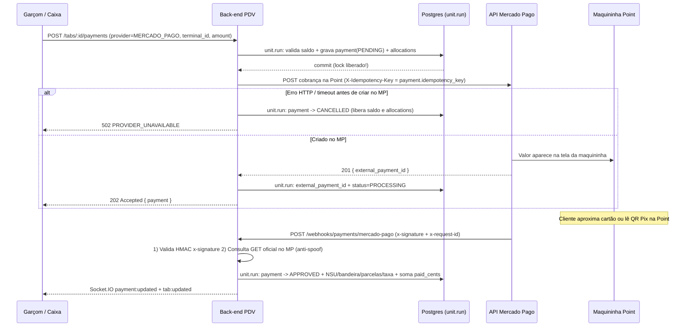

# PDV · 04 · Maquininhas (PaymentProvider) e Módulo Fiscal (NFC-e)

> Regras centrais:
> 1. **Zero custódia:** o dinheiro vai direto da maquininha para a conta bancária do restaurante na adquirente.
> 2. **Zero HTTP dentro de lock:** nenhuma chamada à API de maquininha ou API fiscal roda dentro de `RestaurantUnitOfWork.run`.
> 3. **Uma interface, múltiplos provedores:** tanto maquininhas quanto emissão fiscal entram via pasta `providers/` dentro do respectivo módulo, registrados em `back-end/src/shared/container/container.ts`.
> 4. **Segredos sempre cifrados:** tokens OAuth, chaves de API e CSC são cifrados com **AES-256-GCM** (`back-end/src/shared/utils/crypto.ts`).

---

## 1. Variáveis de ambiente e infra compartilhada

### 1.1 Novas variáveis de ambiente (`back-end/.env`)
```env
# Obrigatória a partir da Etapa 4 (chave 32 bytes em hex = 64 chars: `openssl rand -hex 32`)
CREDENTIALS_ENCRYPTION_KEY=...

# Etapa 4 — Mercado Pago Point (credenciais do seu App de Parceiro no MP Developers)
MERCADO_PAGO_CLIENT_ID=...
MERCADO_PAGO_CLIENT_SECRET=...
MERCADO_PAGO_REDIRECT_URI=https://seu-dominio/api/v1/payment-providers/mercado-pago/oauth/callback
MERCADO_PAGO_WEBHOOK_SECRET=...
MERCADO_PAGO_API_URL=https://api.mercadopago.com

# Etapa 6 — Módulo Fiscal (opcional; cada restaurante informa seu próprio token na config ou usa Org Token)
NOTAAS_API_URL=https://api.notaas.com.br
FOCUS_NFE_HOMOLOG_URL=https://homologacao.focusnfe.com.br/v2
FOCUS_NFE_PROD_URL=https://api.focusnfe.com.br/v2
```

### 1.2 Criptografia de segredos (`back-end/src/shared/utils/crypto.ts`)
- Algoritmo: **`aes-256-gcm`** com IV aleatório de 12 bytes (`crypto.randomBytes(12)`).
- Formato salvo no banco: `v1:<iv_base64>:<authTag_base64>:<ciphertext_base64>`.
- Funções pequenas: `encryptSecret(plain: string): string` e `decryptSecret(encoded: string): string`.
- O prefixo `v1:` permite rotação futura de chave sem quebrar dados antigos.

### 1.3 Captura de `rawBody` no Express (`back-end/src/server.ts`)
Para validar assinaturas **HMAC-SHA256** de webhooks (Mercado Pago, Notaas, Focus NFe), o `express.json` precisa preservar o buffer bruto **somente nas rotas de webhook** (ou via `verify`):
```ts
app.use(express.json({
  limit: "1mb",
  verify: (req, _res, buf) => {
    if (req.url.startsWith("/api/v1/webhooks/")) (req as Request & { rawBody?: Buffer }).rawBody = buf;
  },
}));
```

---

## 2. Arquitetura de Maquininhas (`back-end/src/modules/payments/`)

### 2.1 Estrutura de arquivos
```text
back-end/src/modules/payments/
├── payments.routes.ts
├── webhooks.routes.ts               # rotas /webhooks/payments/* (sem JWT, com HMAC)
├── payments.controller.ts
├── payments.service.ts              # regra de negócio + coordenação transacional
├── payments.schemas.ts
├── payments.interfaces.ts
├── payments.repository.interface.ts
├── payments.repository.ts           # Prisma (restaurantId sempre 1º param)
├── terminals.service.ts             # OAuth, sync e CRUD de maquininhas
└── providers/
    ├── payment-provider.interface.ts
    ├── payment-provider.registry.ts # resolve provider por enum (tsyringe)
    ├── manual.provider.ts           # N0 — funciona com qualquer maquininha
    ├── mercado-pago.provider.ts     # N1 — piloto integrado (Point API)
    └── (futuro: stone.provider.ts, pagbank.provider.ts, cielo.provider.ts)
```

### 2.2 Interface única (`IPaymentProvider`)
```ts
export interface IPaymentProvider {
  readonly kind: PaymentProviderType;
  listTerminals(account: DecryptedProviderAccount): Promise<ExternalTerminal[]>;
  createCharge(account: DecryptedProviderAccount, input: CreateChargeInput): Promise<ProviderChargeResult>;
  getChargeStatus(account: DecryptedProviderAccount, externalId: string): Promise<ProviderChargeStatus>;
  cancelCharge(account: DecryptedProviderAccount, externalId: string): Promise<void>;
  parseWebhook(headers: Record<string, string>, rawBody: Buffer, secret: string): Promise<WebhookEvent | null>;
}
```

### 2.3 Os 4 níveis de integração (convivem na mesma interface)
| Nível | Provedor | Como funciona | Quando usar |
|---|---|---|---|
| **N0** | `MANUAL` | Operador informa meio + valor (+ bandeira/NSU opcionais). Nasce `APPROVED`. | Dia 1, contingência sem internet, dinheiro, qualquer maquininha não integrada. |
| **N1** | `MERCADO_PAGO` (1º piloto), depois `STONE`, `PAGBANK`, `CIELO` | API REST em nuvem dispara o valor para a Smart POS; webhook confirma com NSU, bandeira, parcelas e taxa. | Restaurante com Smart POS conectada ao Wi-Fi/4G. |
| **N2** | `PAYGO`, `SITEF` (futuro) | Estação local no caixa (mesmo modelo da estação de impressão) conversa com PinPad/TEF multi-adquirente. | Redes maiores que exigem TEF dedicado ou múltiplas bandeiras num único PinPad. |
| **N3** | Conciliação (futuro) | Importação de extrato/API da adquirente (D+1) para enriquecer `payments` manuais com taxa real e recebíveis. | Restaurantes no N0 que querem conciliação financeira automática. |

---

## 3. Especificação do piloto N1: Mercado Pago Point (`mercado-pago.provider.ts`)

### 3.1 Conexão OAuth2 por restaurante
1. `GET /api/v1/payment-providers/mercado-pago/oauth/url` (`terminals:configure`):
   - Gera `state` assinado com HMAC (`{ restaurantId, nonce, exp }` — validade 10 min).
   - Redireciona para `https://auth.mercadopago.com.br/authorization?client_id=...&response_type=code&platform_id=mp&state=...&redirect_uri=...`.
2. `GET /api/v1/payment-providers/mercado-pago/oauth/callback`:
   - Valida assinatura e expiração do `state`.
   - Troca `code` via `POST /oauth/token` → recebe `access_token`, `refresh_token`, `user_id`, `expires_in`.
   - Cifra `access_token` e `refresh_token` com `encryptSecret()` e grava em `payment_provider_accounts`.
3. `POST /api/v1/payment-terminals/sync` (`terminals:configure`):
   - Chama `GET /point/integration-api/devices` (ou `GET /terminals/v1/list` conforme versão ativa da Orders/Point API) → sincroniza terminais em `payment_terminals`.
   - Garante que o terminal esteja no modo PDV (`operating_mode = "PDV"`).

### 3.2 Fluxo de cobrança assíncrona (sem segurar lock!)


### 3.3 Validação do Webhook Mercado Pago (`x-signature`)
1. Extrair `ts` e `v1` do header `x-signature` e o header `x-request-id`.
2. Montar o template oficial do Mercado Pago: `id:${dataId};request-id:${requestId};ts:${ts};`.
3. Calcular `HMAC-SHA256(template, webhookSecret)` e comparar com `v1` usando **`crypto.timingSafeEqual`** (nunca `===`).
4. Rejeitar com `401 INVALID_WEBHOOK_SIGNATURE` se inválido ou se `ts` for muito antigo (ex.: > 10 min, proteção anti-replay).
5. Sempre fazer `GET` na API do Mercado Pago para obter o estado autoritativo (nunca confiar apenas no body do webhook).

### 3.4 Mapeamento de estados e job de recuperação
| Estado no provedor | Estado interno `payments.status` | Efeito no saldo da comanda |
|---|---|---|
| Criado / enviado à Point (`OPEN`, `ON_TERMINAL`, `IN_PROCESS`) | `PROCESSING` | Reserva saldo (`pending_cents`) |
| Aprovado (`FINISHED`, `PROCESSED`, `APPROVED`) | `APPROVED` | Soma em `paid_cents`, libera `pending_cents`, grava `confirmed_at` |
| Recusado (`REJECTED`, `ERROR`) | `DECLINED` | Libera saldo e `allocations` |
| Cancelado (`CANCELED`, `ABANDONED`) | `CANCELLED` | Libera saldo e `allocations` |
| Timeout > 5 min sem resposta | `EXPIRED` | Libera saldo e `allocations` |

**Job `back-end/src/shared/jobs/payment-reconciliation.job.ts` (`setInterval(..., 30_000).unref()` em `main.ts`):**
- Busca pagamentos `PROCESSING` com `updated_at < now - 20s` (em lotes de 20).
- Consulta `provider.getChargeStatus` fora do lock; atualiza para `APPROVED`/`DECLINED`/`CANCELLED` se mudou.
- Se `created_at < now - 5 min` e ainda aberto, tenta `provider.cancelCharge` e marca `EXPIRED`.
- Além disso, job diário renova `refresh_token` do OAuth que vence nos próximos 30 dias.

---

## 4. Módulo Fiscal — NFC-e (Etapa 6)

### 4.1 Comparativo real de APIs NFC-e no Brasil (2026)
> **Nota importante:** a **Nuvem Fiscal** encerrou suas operações em 31/07/2026 e não está mais disponível.

| Opção | Custo em Homologação | Custo em Produção | Facilidade em Node.js | Indicação |
|---|---|---|---|---|
| **Notaas** | **Grátis** (até 5 CNPJs em sandbox multi-CNPJ, sem cartão) | **Grátis até 20 notas/mês** (1 CNPJ); planos pagos ao escalar | **Muito alta** (REST JSON, webhooks HMAC-SHA256, upload A1 por API) | **1º adaptador — ideal para MVP e piloto a custo R$ 0** |
| **Focus NFe** | **Grátis** (homologação ilimitada com a SEFAZ) | Pago (~R$ 95/mês solo; Growth ~R$ 572/mês multi-CNPJ) | **Muito alta** (apenas 3 endpoints REST v2, síncrono, Basic Auth) | **2º adaptador — produção consolidada em escala** |
| **ACBrLib (Open Source)** | Grátis | R$ 0 por nota | **Alta complexidade** (FFI `.so`/`.dll`, cert local, NTs SEFAZ na mão) | Só compensa em alto volume futuro |

### 4.2 Estrutura do módulo `fiscal` e `providers/`
```text
back-end/src/modules/fiscal/
├── fiscal.routes.ts                 # /fiscal/settings, /fiscal/tax-profiles, /tabs/:id/nfce, /webhooks/fiscal/*
├── fiscal.controller.ts             # HTTP puro (sem try/catch, sem Prisma)
├── fiscal.service.ts                # emissão, consulta, reenvio, cancelamento e perfis tributários
├── fiscal.mapper.ts                 # converte tab + orders + payments -> payload fiscal neutro + rateio
├── fiscal.schemas.ts                # Zod (CNPJ 14 dígitos, NCM 8, CFOP 4, CSOSN 3-4, justificativa 15-255)
├── fiscal.interfaces.ts
├── fiscal.repository.interface.ts
├── fiscal.repository.ts             # Prisma (restaurantId sempre 1º param)
└── providers/
    ├── fiscal-provider.interface.ts # IFiscalProvider
    ├── fiscal-provider.registry.ts  # resolve MOCK | NOTAAS | FOCUS_NFE (tsyringe)
    ├── notaas.provider.ts           # piloto gratuito (5 CNPJs sandbox + 20 notas/mês grátis)
    ├── focus-nfe.provider.ts        # produção consolidada (3 endpoints REST v2)
    └── mock-fiscal.provider.ts      # testes Vitest sem rede
```

### 4.3 Contrato `IFiscalProvider` (`fiscal-provider.interface.ts`)
```ts
export type FiscalProviderType = "MOCK" | "NOTAAS" | "FOCUS_NFE";

export interface IFiscalProvider {
  readonly kind: FiscalProviderType;
  emitNfce(config: FiscalAccountConfig, input: NfceEmitInput): Promise<NfceProviderResult>;
  getNfceStatus(config: FiscalAccountConfig, reference: string): Promise<NfceProviderResult>;
  cancelNfce(config: FiscalAccountConfig, reference: string, reason: string): Promise<NfceProviderResult>;
  parseWebhook?(headers: Record<string, string>, rawBody: Buffer, secret: string): Promise<NfceProviderResult | null>;
}
```
Campos de entrada/saída:
- **`NfceEmitInput`:** `reference` (`fiscal_documents.id`), `number`, `issuedAt`, `customerDocument?`, `items[]` (`code`, `description`, `ncm`, `cfop`, `csosn`, `origin`, `unit`, `quantity`, `unitPriceCents`, `discountCents`, `additionCents`), `payments[]` (`method`, `amountCents`, `changeCents`, `card?: { brand, acquirerCnpj, authorizationCode, integrated }`).
- **`NfceProviderResult`:** `status` (`PENDING`/`AUTHORIZED`/`REJECTED`/`CANCELLED`), `accessKey` (44 dígitos), `protocol`, `sefazStatus`, `sefazMessage`, `xmlUrl`, `danfeUrl`, `qrcodeUrl`, `rawPayload`.

### 4.4 Mapeamento fiscal neutro (`fiscal.mapper.ts`)
- **Pagamentos (`tPag` SEFAZ):** `CASH→01` (envia `vTroco`), `CREDIT→03`, `DEBIT→04`, `VOUCHER→10/11`, `PIX→17`, `OTHER→99`. Para `CREDIT`/`DEBIT`: grupo `card` com `tpIntegra` (`1` para N1/N2, `2` para N0), `tBand`, `cAut`, `CNPJ` da credenciadora.
- **Invariante matemática SEFAZ:** `Σ(vProd - vDesc + vOutro) === Σ(vPag - vTroco)` no centavo exato. O mapper rateia `adjustments_cents` e `service_fee_cents` proporcionalmente pelos itens ativos e aloca qualquer resto de arredondamento (±1–2 centavos) no item de maior valor.
- **Perfis tributários reutilizáveis (`fiscal_tax_profiles`):** restaurante cria 2–3 perfis (ex.: *Refeição preparada*, *Bebida ST*) + define um `default_tax_profile_id` em `fiscal_settings`. Se faltar NCM/CFOP, falha localmente com `400 FISCAL_TAX_PROFILE_MISSING`.

### 4.5 Mapeamento HTTP dos adaptadores
- **`notaas.provider.ts`:** `Authorization: Bearer <token>`, `POST /api/v1/emitir` (modelo `65`), upload do A1 centralizado na Notaas, webhook assinado com **HMAC-SHA256**.
- **`focus-nfe.provider.ts`:** HTTP Basic Auth (`username = apiToken`, `password = ""`), 3 endpoints:
  - Emitir (síncrono): `POST /v2/nfce?ref=<doc_id>&completa=1`
  - Consultar: `GET /v2/nfce/<doc_id>?completa=1`
  - Cancelar (prazo SEFAZ 30 min): `DELETE /v2/nfce/<doc_id>` `{ "justificativa": "..." }` (15–255 chars).

### 4.6 Execução assíncrona segura
1. `POST /tabs/:id/close` fecha a comanda e, se `fiscal_settings.enabled`, reserva `fiscal_documents(PENDING, next_nfce_number)` dentro do `unit.run`.
2. **Após o commit**, `FiscalService.dispatchEmission(restaurantId, docId)` chama `provider.emitNfce` fora do lock, salva resultado (`AUTHORIZED` ou `REJECTED`) e emite `fiscal:updated` no Socket.IO.
3. Em caso de rejeição SEFAZ, a comanda permanece fechada/paga; o gerente ajusta o cadastro fiscal e aciona `POST /tabs/:id/nfce/retry`.
